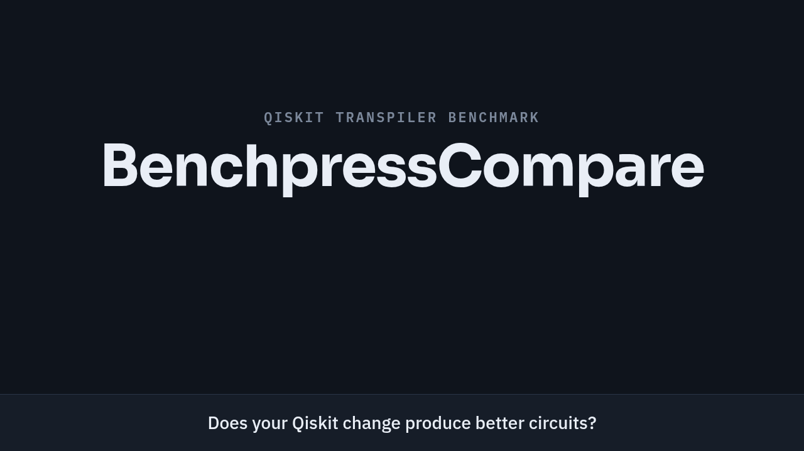

# BenchpressCompare

Compare two Qiskit source versions on the same circuits, targets, and random
seeds. The report measures **native two-qubit gate count (N2)** and **two-qubit
depth (D2)** separately. Scores are `evolve / baseline`: below 1 is better.

Built on the Benchpress circuit corpus, BenchpressCompare adds a balanced
comparison and analysis layer: each of eight circuit families gets equal weight
in the headline scores. Explore results by circuit family, qubit-width band,
target class and optimization level, with charts, tables,
and JSON/CSV exports. 



## Quick start

You need [uv](https://docs.astral.sh/uv/getting-started/installation/), Python
3.12, and two Qiskit source directories containing
`pyproject.toml`. You also need the Rust/Cargo and native compiler toolchain
required by those Qiskit versions. The tool builds each version in its own
environment; you do not need to install Qiskit yourself.

Run these commands from this repository. Replace the source paths with yours.

### 1. Install

```bash
uv sync --locked
```

### 2. Download Benchpress

[Qiskit Benchpress](https://github.com/Qiskit/benchpress) supplies the benchmark
circuits and generator recipes. **Its assets must be downloaded separately;
they are not included in this repository.** Use this exact revision:

```bash
git clone https://github.com/Qiskit/benchpress.git ../benchpress
git -C ../benchpress checkout 4c04b38a53fc231a89f1a6bc9541c1b641ed6dcf
```

**`--corpus` is the path to that BenchPress checkout's root directory**, such as
`../benchpress`.

### 3. Run locally

Start with the small profile:

```bash
uv run benchpress-compare run \
  --baseline ../qiskit-baseline \
  --evolve ../qiskit-evolve \
  --corpus ../benchpress \
  --store ./benchmark-store \
  --results-root ./benchmark-results/local-small \
  --profile small
```

`run` builds both Qiskit versions, freezes the benchmark plan, collects results,
and writes reports. No separate `prepare` command is needed.

| Option | Meaning |
| --- | --- |
| `--baseline` | Qiskit source directory used as the reference. |
| `--evolve` | Qiskit source directory with the changes you want to evaluate. |
| `--corpus` | Local BenchPress checkout or extracted archive. |
| `--store` | Shared cache for baseline builds and successful baseline measurements; reuse it across runs. |
| `--results-root` | Output directory for this comparison; use a new one for each change or profile. |

The store and results directory must be separate and outside both Qiskit source
trees. For an A/A check, pass the same source directory to both `--baseline` and
`--evolve`; both sides still execute independently.

## Run on LSF

Submit a complete comparison:

```bash
uv run benchpress-compare run \
  --baseline ../qiskit-baseline \
  --evolve ../qiskit-evolve \
  --corpus ../benchpress \
  --store ./store \
  --results-root ./results/lsf-small \
  --profile small \
  --executor lsf --lsf-config lsf-site.toml
```

## Choose a profile

All profiles use the same eight circuit families, weights and seeds; they
differ in how many circuits, targets and levels they cover. `small` is a
subset of `evolve`, and `evolve` a subset of `full`.

| | `small` | `evolve` | `full` (default) |
| --- | --- | --- | --- |
| Use it for | quick sanity check of a candidate | fitness signal in a search loop | the benchmark; confirming a result |
| Circuits | 22 | 44 | 147 (136 weighted) |
| Qubits | 8–64 | 8–129 | 8–129 |
| Targets | heavy-hex | heavy-hex | square, heavy-hex, FakeTorino |
| Optimization levels | 2 | 2 | 2 and 3 |
| Compilations (3 seeds, both arms) | 132 | 264 | 5,292 |
| Circuits and weights | [small](docs/profiles/small.md) | [evolve](docs/profiles/evolve.md) | [full](docs/profiles/full.md) |

Start with `small`, search with `evolve`, confirm with `full`. 

Each family gets 1/8 of the score. Inside a family the small, medium and large
bands are weighted 20:30:50 over the bands the family has, then split equally
over recipes and circuits. 


## Read results


When collection finishes, open `<results-root>/reports/report.md` for the readable
summary. It leads with the headline N2 and D2 scores and embeds the charts
written to `<results-root>/reports/charts/` as PNG and SVG; `summary.json` next
to it holds the exact data behind every number. For scripts, `result.json` in
the same directory reduces all of this to N2, D2 and one state, and
`benchpress-compare result` prints it for a run in any phase; see
[Read the result from a script](docs/result.md).

Some failures change which score you get:

- **Baseline fails on an input.** That input is left out of the score. It still
  appears in the report, with zero weight.
- **Evolve fails on an input the baseline completed.** The report shows no main
  score. It shows a partial score instead: one that leaves out the failed
  circuits, labelled with how many it leaves out and how much of the total
  weight they carry.
- **A circuit family ends up with no inputs.** The report shows no score, because
  the missing family's weight is not handed to the other families. To score
  anyway, rerun with `--allow-missing-families`; the report then labels the
  result as a reduced design.

Before trusting a score, check the exclusions and failures listed next to it.
