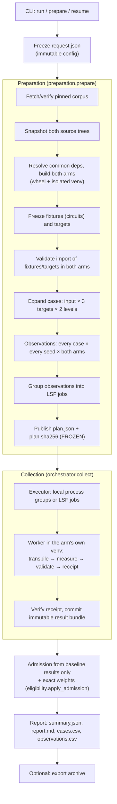

# Benchmark flow (high level)

This document walks through what `benchpress-compare` does end to end, from the
CLI call to the final report. It covers the code under
[src/benchpress_compare/](../src/benchpress_compare/). For the scientific rationale see
[high_level_design.md](design/high_level_design.md); for validation scope see
[validation_coverage.md](validation_coverage.md).

## What is being compared

Two Qiskit source trees, **baseline** and **evolve**, compile the same frozen
circuits on the same frozen targets with the same seeds. For each compiled output
the harness measures two independent metrics:

- **N2**: the number of native two-qubit gates.
- **D2**: the two-qubit depth, meaning the longest dependency path where only
  two-qubit gates count.

The result is a weighted score per metric, `evolve / baseline`. A score below 1
means evolve produces smaller or shallower output.

## The big picture

Nothing is measured before the plan is frozen. Every candidate circuit is compared
on both arms, and the decision about which circuits count is made afterwards, from
baseline results only.



The run moves through these states, which are recorded in `state/status.json` and the
event journal:

```
NEW → PREPARING → FROZEN → RUNNING → COMPLETE | COMPLETE_WITH_FAILURES
          (or PREPARATION_FAILED / NEEDS_RECONCILIATION / INTERRUPTED / CANCELLED)
```

## 1. Entry point: CLI ([cli.py](../src/benchpress_compare/cli.py))

| Command | What it does |
|---|---|
| `prepare` | Runs preparation and stops after the plan is frozen. |
| `run` | Runs preparation (or reuses a frozen plan), then collection. |
| `resume` | Continues from the saved `request.json`. It can reopen cancelled work with `--retry-cancelled`. |
| `status` / `cancel` | Reads run state, or cancels only the jobs and processes this run recorded. |
| `report` | Rebuilds reports offline from committed observations, with optional filters and grouping. |
| `export` | Writes a self-contained tar of verified artifacts. The controller must be stopped. |
| `audit` | Checks the checked-in catalogue and, optionally, a corpus mirror. |

The first invocation writes `request.json` with the configuration
([config.py](../src/benchpress_compare/config.py)) and a hash of the coordinator code. After
that the configuration is immutable: supplying a different value is an error, and
changing the coordinator code invalidates the run.

With `--executor lsf`, the CLI does not run the work itself. It submits a long-lived
**controller job** ([controller.py](../src/benchpress_compare/controller.py)), which runs the
hidden `_controller` command on the cluster. `--wait` follows that job from the
client. The coordinator process never imports Qiskit. All Qiskit work runs in
per-arm worker environments.

## 2. Preparation ([preparation.py](../src/benchpress_compare/preparation.py))

Preparation runs under an exclusive controller lease. Every step is resumable: each
step checks for and verifies its saved output before redoing any work. Preparation
never compiles a benchmark circuit; it only builds, freezes and plans.

### 2.1 Inputs and builds
1. **Corpus**: uses the `--corpus` mirror, or downloads the pinned Benchpress
   revision, and verifies it against the catalogue
   ([corpus/](../src/benchpress_compare/corpus/), [data/candidates.json](../data/candidates.json)).
   The catalogue has 149 candidates: 138 main-table inputs and 11 additional ones,
   five of which are declared structural variants of a main input.
2. **Source snapshots**: content-addressed copies of both source trees
   ([builds/snapshot.py](../src/benchpress_compare/builds/snapshot.py)). The baseline
   snapshot goes into the shared store. Later edits to the live source directories
   have no effect on the run.
3. **Builds**: a `resolve-dependencies` task produces one common dependency lock.
   Then both arms build concurrently into release wheels and isolated venvs
   ([builds/release.py](../src/benchpress_compare/builds/release.py)). The paired builds
   must agree on dependencies, Python, platform and toolchain; only the Qiskit source
   may differ. Baseline builds are cached in the store under a content key that
   includes the harness wheel, so a harness change rebuilds both arms.

Each preparation step runs as a durable **task** through the same execution engine
as observations ([tasks.py](../src/benchpress_compare/tasks.py), [worker/](../src/benchpress_compare/worker/)).

### 2.2 Frozen fixtures, targets and cases
4. **`freeze-fixture`** (one task per candidate): loads each Benchpress circuit and
   serializes it to a typed, Qiskit-version-neutral IR
   ([corpus/ir.py](../src/benchpress_compare/corpus/ir.py)). QPY is not used as the
   cross-build format.
5. **`freeze-targets`**: builds synthetic **square** and **heavy-hex** targets sized to
   each declared width, plus a **fake_torino** snapshot (133 qubits)
   ([targets.py](../src/benchpress_compare/targets.py)).
6. **`validate-import`**: both arms must import every fixture and target and return
   the same hashes.
7. **Case expansion**: each fixture is paired with 3 target classes and 2
   optimization levels (2, 3), giving **6 cases per input**. The case ID hashes the
   fixture, the target, the level and the transpile contract
   ([schema.py](../src/benchpress_compare/schema.py) `TRANSPILE_CONTRACT`). Each case
   gets `--seeds` comparison seeds from phase-separated SHA-256 streams
   ([seeds.py](../src/benchpress_compare/seeds.py)), and every case uses the same
   **runtime profile** taken from the request (`--wall-seconds`,
   `--worker-memory-gb`, `--native-threads`).
8. Everything above is written to `preparation.json`, a contract that must not
   change on resume.

### 2.3 Plan and job layout
9. **Observations** ([planner.observations_for](../src/benchpress_compare/planner.py)):
   every case × every seed gets one baseline and one evolve observation. Arm order
   alternates deterministically. With the full catalogue and 3 seeds that is
   149 × 6 × 3 × 2 = **5,364 observations**.
10. **Jobs** ([planner.shard_bundles](../src/benchpress_compare/planner.py)), LSF only:
    - Every observation of an input in `BIG_CIRCUITS` runs as **its own job**, so
      baseline and evolve run separately. These are the seven inputs whose single
      compiles took about 3 to 25 minutes in earlier baseline measurements, for
      example `Q/large/bwt_n37` and `Q/large/square_root_n60`.
    - All other observations are cut in plan order into sequential jobs of at most
      `shard_max_observations` (default **6**, which is exactly one case: 3 seeds on
      both arms), and never more than the job wall limit can hold if every
      observation used its full watchdog.

    With the full catalogue that is **1,104 jobs**: 252 single-observation jobs for
    the big inputs and 852 one-case jobs for the rest. The local executor ignores
    this grouping and runs each observation as its own process.
11. **Publish**: `plan.sha256` is written first, then `plan.json`. The plan contains
    the cases, builds, observations, jobs (`bundles`), the `BIG_CIRCUITS` list, the
    admission policy and artifact hashes. It has no weights: those are computed
    after collection. The run is now **FROZEN**, and every later step verifies the
    plan hash and the hashes of its artifacts.

## 3. Collection ([orchestrator.py](../src/benchpress_compare/orchestrator.py))

`collect()` verifies the plan and the builds, takes the lease, replays the journal
and calls `ExecutionEngine.run(plan["observations"])` with the frozen jobs. For each
observation:

1. **Reuse check**: if a verified result bundle already exists, it is kept. A
   baseline observation whose identity matches a successful, verified entry in the
   store's `baseline/observations` is copied in as a **cache hit**. Evolve
   observations are always measured fresh.
2. **Adopt or launch**: live attempts from an earlier run are adopted, not
   duplicated. Otherwise a new attempt directory with `spec.json` is created and
   submitted.
3. **Executors**:
   - [executors/local.py](../src/benchpress_compare/executors/local.py) runs each
     attempt as a fresh process group with a process-tree watchdog and resource
     limits.
   - [executors/lsf.py](../src/benchpress_compare/executors/lsf.py) submits with
     `bsub`, polls with one `bjobs` call per cycle, and falls back to `bhist`.
     Multi-observation jobs run as shards ([worker/shard.py](../src/benchpress_compare/worker/shard.py)),
     which execute children one after another, each in a fresh subprocess with its
     own receipt. Dispatch respects the site's `max_jobs`, `max_cpus` and
     `max_memory_gb`; with 32 GB per job and a 2,000 GB cap, at most 62 jobs run
     at once.
4. **Commit**: the receipt's identity fields and artifact hashes are checked
   against the spec. The result is then published atomically as an immutable
   bundle under `observations/`. Successful, verified baseline results are also
   published to the shared store for reuse by later runs.
5. **Failures**:
   - Infrastructure failures are retried up to `--infrastructure-retries`.
   - Compiler failures, invalid output, resource limits and harness failures are
     terminal for that observation.
   - Uncertain scheduler state moves the run to **NEEDS_RECONCILIATION**; the
     harness never speculatively resubmits.

When all observations reach a terminal status, the run becomes `COMPLETE` or
`COMPLETE_WITH_FAILURES`, and a report is written automatically.

### What a worker does ([worker/\_\_init\_\_.py](../src/benchpress_compare/worker/__init__.py))

The worker runs as `python -m benchpress_compare.worker spec.json`, using the
arm's own venv Python:

1. It attests the runtime: the Qiskit origin and the wheel and native extension
   hashes must match the build manifest. It also sets the pinned thread environment.
2. It loads the frozen fixture and target and checks their hashes against the spec.
3. **Compile** ([worker/adapter.py](../src/benchpress_compare/worker/adapter.py)): it
   builds the preset pass manager for the given level and seed and runs it.
   Instrumentation records the pass timeline, whether SABRE ran, the number of
   inserted SWAPs at the native boundary, and a pre-layout structural hash. The
   adapter observes these values only; it does not change compilation.
4. **Measure** ([metrics.py](../src/benchpress_compare/metrics.py)): it computes N2 and D2
   on the exported IR, without Qiskit.
5. **Validate** ([validation/](../src/benchpress_compare/validation/)): it checks
   recursive native target legality (`target-legality-v4`). If validation fails, the
   observation is `INVALID`, not `SUCCEEDED`. Semantic equivalence is not checked.
6. It writes the artifacts (the output, initialization and pre-layout circuits
   gzipped, plus layout, diagnostics and validation) and an immutable
   `receipt.json` with resource telemetry.

## 4. Admission and weights ([eligibility.py](../src/benchpress_compare/eligibility.py), [weights.py](../src/benchpress_compare/weights.py))

Admission runs after collection, every time a report is built, and reads **only
baseline results**:

1. **Drop rule**: an input is **dropped** when any of its baseline observations, in
   any of its 6 cases and any seed, did not succeed with verified target legality,
   or is missing. Its reason is `baseline_failed` or `baseline_missing`, and the
   failing case, seed and status are listed.
2. **Structural variants**: of a main input and its declared variants, only the
   first in `[main, *sorted(variants)]` whose baseline succeeded is scored; the
   others are dropped as `structural_duplicate`.
3. **Evolve never drops anything**. An evolve failure where baseline succeeded
   stays in the score and counts against evolve (see section 5).
4. **Weights**: exact fractions over the admitted inputs. Each of the 8 families
   gets 1/8. Within a family, bands get priorities S=1/5, M=3/10, L=1/2, which are
   renormalized over the bands the family actually has. Within a band, the weight
   is split equally across recipes, then across the inputs of each recipe, then
   across that input's 6 cases. Dropped inputs stay in the report with zero weight.
5. If the admitted inputs leave a family empty in the standard eight-family design,
   no weights are assigned and the report shows no score with the reason; weight
   is never redistributed. `--allow-missing-families` selects the explicitly
   reduced design instead, and a `--smoke` subset is always its own design.

## 5. Scoring and reports ([aggregate.py](../src/benchpress_compare/aggregate.py), [report.py](../src/benchpress_compare/report.py))

N2 and D2 are scored separately:

1. **Per case**: the exact rational ratio `mean(evolve seeds) / mean(baseline seeds)`.
   A missing seed, a failure, or a zero baseline makes the case unavailable.
2. **Per slice or overall**: a weighted geometric mean of the case ratios. If any
   selected case is unavailable, the slice has no score. Weight is never
   redistributed.
3. **Per circuit**: each input is classified **better**, **same** or **worse** from
   the exact product of its case ratios. An input with an unavailable case is
   **unclassifiable**.
4. **Failures**: the report lists failure counts per arm and every evolve
   observation that failed where baseline succeeded. Any such failure makes the
   main score unavailable.
5. **Score without evolve failures**: alongside the main score, the report gives a
   clearly labelled **partial** score over the circuits where evolve did not fail,
   with how many circuits and how much weight it leaves out. It must be read
   together with the Failures section.
6. Seed spread is reported as descriptive statistics only. There is no
   significance test and no pass/fail threshold.

Reports are written to `results-root/reports/`:
- `summary.json`: the authoritative model, including `admission`, `failures` and
  `score_without_evolve_failures`.
- `report.md`: the readable summary.
- `cases.csv`
- `observations.csv`

`benchpress-compare report` can rebuild them offline, filtered by circuit,
target, level, family, band or recipe.

## 6. Durability and integrity (cross-cutting)

- **Identities** ([identity.py](../src/benchpress_compare/identity.py)): every case,
  observation, build and plan is named by a canonical JSON SHA-256. Writes use
  atomic rename plus fsync.
- **Store and leases** ([store.py](../src/benchpress_compare/store.py)): results are
  verified immutable bundles. A fenced filesystem lease ensures only one controller
  writes to a results root at a time.
- **Journal** ([journal.py](../src/benchpress_compare/journal.py)): an append-only,
  hash-chained event log in `state/events.jsonl`.
- **Schema** ([schema.py](../src/benchpress_compare/schema.py)): records are validated at
  artifact boundaries, and the protocol versions are pinned in `PROTOCOLS`.
- **Export** ([export.py](../src/benchpress_compare/export.py)): archives the verified
  results, snapshots, wheels and locks. Venvs are omitted because they cannot be
  relocated; they are recreated from the archived metadata.

## Results directory at a glance

```
results-root/
  request.json             frozen config + coordinator hash
  state/                   status.json, events.jsonl, controller lease
  snapshots/               evolve snapshot + references to the baseline snapshot in the store
  builds/                  build manifests (evolve build lives here; baseline in the store)
  preparation/             corpus manifest, dependency lock, harness wheel
  fixtures/inputs|targets/ frozen circuit and target JSON
  tasks/                   preparation task results
  preparation.json         preparation contract
  plan.json, plan.sha256   the frozen plan (cases, observations, jobs)
  jobs/                    controller and shard job records
  attempts/                one directory per attempt, with spec, receipt and artifacts
  observations/            committed comparison results (one bundle per arm × observation)
  reports/                 summary.json, report.md, cases.csv, observations.csv

store/                     shared across runs
  sources/                 baseline source snapshots
  baseline/wheels/         baseline builds
  baseline/observations/   reusable verified baseline results
