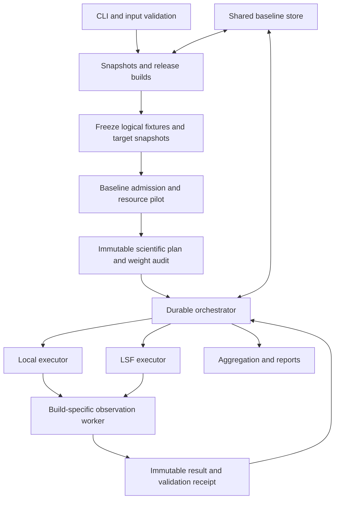

# Benchpress comparison: detailed implementation plan

Prepared 2026-11-09. **Status: implementation proposal. No builds, eligibility
screening, cluster jobs, or benchmark collection have been run for this plan.**

Validation contract updated 2026-11-10: `target-legality-v4` requires only
recursive native target legality. `sabre-native-counts-v3` preserves routing
activity and SWAP count diagnostics for admission. Layout validation, routing
replay, and semantic equivalence checks are outside the current contract.

## 1. Objective and source of truth

Implement the [high-level design](high_level_design.md): compare two Qiskit source
folders using final native two-qubit count (N2) and two-qubit depth (D2), with
reusable baseline work, local and LSF execution, resumable collection, and weighted
reports for arbitrary slices.

The [requirements](requirements.md) define the requested capabilities. The
[subset specification](benchpress_subset_spec.md) controls circuit inventory,
targets, admission, families, bands, recipes, and weights. The
[earlier detailed experiment plan](old/benchpress_for_sabre_claude_high_level_plan.md)
supplies supporting rationale where consistent with those documents. Its older
shortlists and other experiments in the reference repositories are not defaults
for this implementation. Some study links in the subset specification predate the
move into `old/`; use the actual files there.

This repository currently contains design documents, with no application package
or test suite. Build a standalone Python package, `benchpress_compare`, with the
proposed command `benchpress-compare`. These names and commands describe work to
implement; they are not currently executable.

The first delivery includes the complete native-corpus workflow, both executors,
and Markdown/JSON/CSV reports. It does not include a web UI, a compiler-speed
benchmark, automated significance claims, a combined N2/D2 score, or a release
pass/fail policy. Parallel instrumented timings are resource-planning diagnostics.

## 2. Non-negotiable comparison contract

| Area | Required behavior |
| --- | --- |
| Inputs | Explicit `baseline`, `evolve`, `store`, and `results-root` paths; default comparison seed count 3, configurable to a positive integer. |
| Builds | Snapshot actual source contents, build isolated release wheels whose native extensions use the source tree's optimized release profile, and verify the imported binaries. CPU-specific targeting is optional and recorded (§6). Never use an unverified editable checkout. |
| Corpus | Pin Benchpress to `4c04b38a53fc231a89f1a6bc9541c1b641ed6dcf`; verify asset hashes. |
| Targets | Square, complete heavy-hex, and one frozen FakeTorino snapshot; every admitted input uses all three at L2 and L3. |
| Compiler settings | Full preset transpilation; no supplied initial layout; `approximation_degree=1.0`; 20 layout trials, 20 layout-swap trials, and 20 standalone routing trials where executed. Preserve level-specific iterations and record deterministic starts. |
| Arm configuration | Compare the supplied folders with identical harness settings. Do not inject wait-time or other heuristic changes unless explicitly declared in the frozen configuration. |
| Admission | Baseline only, three independent preflight seeds, SABRE executed in every seed and median inserted SWAP count at least 10 in each of six configurations; no verified zero-routing embedding; supported metrics and validation. |
| Circuit validation | Recursive native target legality only; no layout validation, routing replay, or semantic equivalence guarantee. |
| Cohort | Freeze admission, exclusions, seeds, labels, targets, validation policy, and exact weights before any evolve benchmark measurement. An evolved SABRE bypass does not remove a case. |
| Seeds | Identical comparison seeds for both builds; all planned seeds required; comparison seeds never overlap preflight or pilot seeds for a case. |
| Scores | Ratio of arithmetic seed means, then weighted geometric mean, independently for N2 and D2. Missing or unusable ratios never trigger survivor reweighting. |
| Execution | Shared worker protocol and scientific plan for local and LSF. Matching runtime/resource profiles for each baseline/evolve pair. |
| Recovery | Immutable successful observations; bounded infrastructure retries with unchanged seeds; reconcile live or uncertain jobs before submitting replacements. |
| Storage | Shared store contains reusable baseline artifacts; evolved artifacts remain under the comparison's results directory. Only complete verified entries are reusable. |

The screen covers **149 candidates: 138 main-table candidates plus all 11 additional
screening candidates in subset §5**. That requires `149 × 3 × 2 × 3 = 2,682`
baseline preflight observations, before retries or separate pilots. Five of the 11
are structural variants; screening them does not authorize double weighting.
Known-local coverage entries remain separately catalogued at zero main weight.

For `I` admitted distinct inputs and `s` comparison seeds:

```text
main cases                 = 6 I
main baseline observations = 6 I s
main evolve observations   = 6 I s
main total observations    = 12 I s
```

The subset's 828 cases and 4,968 main observations assume all 138 main-table inputs
are admitted and `s=3`. Actual admission can change those counts. A smoke subset is
always labelled as such and cannot claim the complete eight-family score.

## 3. Architecture and package boundaries

Keep the coordinator independent of Qiskit. Each build runs its own Python worker
in an isolated process. Transfer versioned data and artifacts across this boundary,
not Python objects or imports from one arm into the other.



| Proposed module | Responsibility |
| --- | --- |
| `cli.py`, `config.py` | Commands, path validation, common settings, site configuration, exit codes. |
| `schema.py`, `identity.py` | Typed records, schema versions, canonical encoding, content hashes, stable identifiers. |
| `builds/` | Source snapshots, dependency/toolchain locks, release wheels, environments, import attestations. |
| `corpus/` | Checked-in candidate catalogue, pinned asset lookup, fixture construction, aliases, structural deduplication. |
| `targets.py` | Exact graph sizing, target serialization, provider snapshot extraction, import validation. |
| `worker/` | Build-specific imports, preset adapter, pass instrumentation, observation protocol, process receipt. |
| `metrics.py`, `validation/` | Versioned N2/D2 and recursive native target-legality evidence. |
| `eligibility.py`, `weights.py`, `seeds.py` | Baseline admission, exact rational allocations, domain-separated seed lists. |
| `pilot.py`, `planner.py` | Resource measurements, worker recommendations, case bundles, LSF packing. |
| `store.py`, `journal.py` | Atomic artifacts, cache lookup/publication, leases, event journal and checkpoints. |
| `orchestrator.py`, `executors/` | Shared state machine; local subprocess and LSF scheduler adapters. |
| `aggregate.py`, `report.py` | Complete-score rules, slice queries, circuit counts, Markdown/JSON/CSV output. |

Create `pyproject.toml`, a supported Python/dependency lock, `src/benchpress_compare/`,
`tests/`, and `data/candidates.json`. Use standard-library dataclasses, enums,
fractions, subprocesses, and JSON where sufficient; validate public artifacts
against explicit schemas. Pin the tested coordinator Python version and build
dependencies in milestone M0. Worker compatibility is a separately tested contract
for the supplied Qiskit folders, not a claim to support every historical release.

### Reference reuse boundaries

Adapt small components with provenance and license notices, backed by local tests.
Do not require sibling repositories at runtime or import their private modules
through a developer-specific path.

| Inspected reference | Reuse | Required change |
| --- | --- | --- |
| [qtb build support](../../../qiskit-transpile-bench/src/qtb/envbuild/__init__.py) | Content snapshots, wheel construction, dependency locks, native import checks. | Make release policy explicit; extend ABI/CPU checks. qtb overrides release LTO/codegen settings, which must not be inherited silently. |
| [qtb store](../../../qiskit-transpile-bench/src/qtb/coordinator/store.py), [storage](../../../qiskit-transpile-bench/src/qtb/coordinator/storage.py) | Complete-entry publication, final-path virtual environments, fenced host locks. | New namespace and keys; per-observation reuse; verify actual shared-filesystem behavior. |
| [qtb worker adapter](../../../qiskit-transpile-bench/worker/qtb_worker/adapter.py) | Typed fixture/target serialization, layout records, pass-boundary snapshots. | Verify support for this full corpus, conditions, resets, custom definitions, and both build versions. |
| [qtb metrics](../../../qiskit-transpile-bench/src/qtb/metrics/__init__.py) | Streaming metrics. | Existing D2 rejects control flow; implement and test recursive metric support. Routing replay is not part of the current contract. |
| [existing balanced comparison](../../../qiskit-transpile-bench/compare_to_baseline_benchpress/README.md) | Freeze/resume structure and reporting examples. | Its generated circuits, target sizes, corpus pin, weights, and forced evolved heuristic define a different experiment. |
| [bpkit planner](../../../bpkit/bpkit/plan.py), [controller](../../../bpkit/remote/controller.py), [shard worker](../../../bpkit/remote/run_shard.py) | Cost-aware ordering, controller-as-job, durable submission intent, receipts and reconciliation. | Remove fixed corpus/shards, queue/reservation paths, two-thread assumptions, and whole-arm retry behavior. |

## 4. User workflow and configuration

Implement these commands. All examples below are proposed interfaces.

```bash
# Prepare and execute the whole comparison locally.
benchpress-compare run \
  --baseline /sources/qiskit-baseline \
  --evolve /sources/qiskit-evolve \
  --store /benchmarks/store \
  --results-root /benchmarks/results/change-001 \
  --executor local --seeds 3

# Run preparation through admission, pilot, and immutable plan publication.
benchpress-compare prepare \
  --baseline /sources/qiskit-baseline \
  --evolve /sources/qiskit-evolve \
  --store /benchmarks/store \
  --results-root /benchmarks/results/change-002 \
  --executor lsf --lsf-config /benchmarks/site.toml --seeds 5

benchpress-compare run --results-root /benchmarks/results/change-002
benchpress-compare status --results-root /benchmarks/results/change-002
benchpress-compare resume --results-root /benchmarks/results/change-002
benchpress-compare report --results-root /benchmarks/results/change-002 \
  --family F2 --band L --level 3
benchpress-compare cancel --results-root /benchmarks/results/change-002
benchpress-compare export --results-root /benchmarks/results/change-002 \
  --output /benchmarks/archives/change-002.tar
```

`run` on a new directory executes preparation and collection. On an existing
compatible directory it continues the saved workflow. `prepare` stops at the
frozen plan. `resume` also supports an interrupted preparation; it never reselects
the cohort after final freeze. `status` is read-only. `report` reads committed
artifacts without importing Qiskit and can regenerate reports during collection.
`cancel` cancels only the jobs and local process groups recorded for this run
(§11). `export` materializes the store artifacts a results directory references
into a portable archive (§5).

Expose the following configuration groups, with effective values saved:

- Scientific: seed count/master seed, pinned corpus location, declared arm options,
  validation/metric protocols. The standard design fixes targets, levels, trial
  budgets, and weighting; incompatible experimental overrides need a differently
  named design and a new results directory.
- Local resources: `--workers auto|N`, CPU/memory budget, native threads per worker
  (default 1), bootstrap limits, per-observation resource ceilings.
- LSF: queue, project/reservation if required, host/CPU selection, controller and
  build resources, maximum active jobs/CPU/memory, polling interval, job wall limit,
  memory request/limit semantics, and accounting command support.
- Reliability: default **one additional infrastructure attempt**, observation
  watchdogs, scheduler visibility grace, lease heartbeat, and log/artifact retention.
- Coverage: explicitly selected supplemental collection and smoke filters; record
  them before execution and keep their results separate from main scoring.

For LSF, submit the preparation/collection orchestrator as an LSF job and return
its ID immediately. Provide an optional client-side `--wait` that follows progress;
closing that client must not stop the orchestrator. Preparation commands use LSF
workers too. Stage source snapshots from the launch host when necessary, then build
on the execution platform. A macOS-built wheel cannot serve Linux cluster workers.
All required artifacts must be on a shared, worker-visible filesystem; arbitrary
remote file transport is outside the first version.

Validate path existence, source readability, writable destinations, non-overlap of
store/results, and destinations outside source trees. An existing results folder
with incompatible identities is an error, not permission to overwrite it. Require
all four paths only for a new run; continuation reads the pinned snapshots and
store location. Changes to live source folders do not change an existing run.

Exit codes distinguish success, command/configuration error, preparation failure,
collection with failed or unavailable scored observations, infrastructure needing
reconciliation, and interruption.
Asynchronous submission success means the controller was submitted; terminal run
status is available through `status` or `--wait`. A regression alone is not an
execution failure because no acceptance threshold has been requested.

## 5. Durable data model and storage layout

Every public record has a schema version. Hash canonical, explicitly typed data;
exclude timestamps, hostnames, log paths, and display labels from scientific
identities. Preserve those values as provenance. Reject unknown incompatible
versions rather than interpreting them approximately.

| Record | Required content |
| --- | --- |
| `SourceSnapshot` | Actual tree hash, source file manifest/modes, source location, Git revision and dirty status when available, submodule identities, archive hash. |
| `BuildManifest` | Snapshot, toolchain, build backend, resolved dependencies, Python/ABI/platform, CPU features, effective release flags, wheel/native hashes, environment/harness identity, verification evidence. |
| `InputFixture` | Canonical input ID and aliases, source record/path, corpus hash, logical artifact hash, declared/active width, family/recipe/band, parameter bindings, initialization/ancilla semantics, deduplication evidence. |
| `TargetSnapshot` | Class and snapshot ID, physical width, ordered edges/instruction support, calibration and timing properties including absence, provider provenance, canonical hash. |
| `EligibilityRecord` | Three baseline seeds per target/level; pass/SWAP diagnostics; embedding, metric and target-legality status; admission/exclusion/unresolved reason; policy version. |
| `Case` | Input/target hashes, level, configuration hash, stable case ID, occupancy, exact weight factors and main/sensitivity weights, comparison seeds. |
| `ObservationSpec` | Case, phase, build, seed, worker/instrumentation/metric/validation identities, runtime profile, logical observation ID. |
| `Attempt` | Observation ID, attempt ID, executor/job ID, submission token, lease generation, timestamps, host receipt, resource usage, exit classification, logs and artifact hashes. |
| `ObservationResult` | Matching identity fields, N2/D2 or metric-specific unavailable reasons, pass diagnostics, validation evidence, output/layout artifact references, accepted attempt. |
| `RunPlan` | Input configuration, all immutable references above, candidate/coverage disposition, expected work counts, weights audit, seed algorithm, retry/resource policies, plan hash. |

The scientific observation ID is independent of the attempt number or scheduler
job ID. Retries cannot create additional weighted observations. Define
`case_id = H(fixture hash, target hash, level, transpilation-contract hash)`.
Exclude weights, labels, cohort membership, resources, and requested seed count;
this avoids dependence on admission and lets a higher-seed run reuse compatible
baseline observations. Resource compatibility remains in observation identity.

```text
store/benchpress-compare/v1/
  sources/<baseline-tree-hash>/             # baseline snapshots only
  baseline/wheels/<build-key>/
  baseline/envs/<environment-key>/          # final path; READY published last
  baseline/observations/<observation-key>/  # result, artifacts, COMPLETE
  baseline/eligibility/<evidence-key>/
  locks/

results-root/
  request.json                              # original invocation and paths
  preparation.json                          # immutable initial preparation contract
  preparation/revisions/                    # append-only, hash-linked amendments
  snapshots/                                # evolve snapshot; baseline reference
  builds/evolve/                            # wheel, environment, manifest, logs
  builds/baseline.json                      # verified shared-store reference
  fixtures/inputs/ and fixtures/targets/
  eligibility/ and pilot/
  plan.json and plan.sha256                 # published only after preparation
  coverage.json and weights.json
  execution/revisions/                      # packing/concurrency revisions
  state/events.jsonl and state/checkpoint.json
  attempts/<observation-id>/<attempt-id>/
  observations/<observation-id>/            # accepted results or cache receipts
  jobs/ and logs/
  reports/report.md, summary.json, cases.csv, observations.csv
```

The store owns all artifacts needed to reuse a baseline result; it must not point
back into a deletable comparison directory. Results preserve exact cache keys and
checksums, with an export mode that materializes referenced artifacts for a portable
archive. No automatic cache garbage collection is required for the first version.

### Publication and concurrency

Use a per-key shared-store lease with exclusive creation, owner identity,
heartbeat, and fencing token. A stale writer must not publish after another owner
takes over. Validate these operations on the actual cluster filesystem in M8.
Create immutable file bundles in a private directory on the same filesystem,
`fsync` their files, verify hashes, atomically rename/publish the completion marker,
and `fsync` the containing directory where supported. Record platform/filesystem
durability limitations in the site validation evidence.
Readers ignore incomplete bundles. Build virtual environments at their final
paths because their scripts may contain absolute paths; publish `READY` last.

Only the active orchestrator updates the central journal/checkpoint. Workers
publish independent receipts. Checkpoints are replaceable projections of durable
events and accepted receipts. Recovery tolerates an interrupted last JSONL record,
but rejects corruption in previously committed records. Use unique temporary
filenames and atomic replacement for checkpoints.

## 6. Source preparation, release builds, and reuse

1. Snapshot both folders without modifying them. Include tracked content and
   relevant unignored/untracked source, deletions, executable modes, and supported
   in-tree symlinks. Exclude build outputs by explicit policy, not by deleting every
   directory named `target`. Materialize submodules deliberately; reject escaping
   links. Detect concurrent source edits and retry or fail the snapshot.
2. Resolve and lock a common compatible dependency/toolchain environment. If the
   two source versions cannot use it, fail preparation with the conflicting
   requirements; version-specific dependency comparisons need an explicit new
   contract, not a silent resolver divergence.
3. Build noneditable wheels from copied sources using the selected release profile.
   The default is the source tree's own release profile with no overrides; a
   build-speed override such as thin LTO or extra codegen units must be declared,
   applied identically to both arms, and included in the build key.
   Record the build command, effective Cargo profile, optimization level, LTO,
   codegen units, Rust/C/C++/linker flags, target triple, CPU feature policy, and
   build-backend versions. Reject debug/dev builds and optimization-disabling
   overrides. Verify lockfiles were not silently changed by the build.
4. Install each wheel plus the pinned worker/harness into an isolated environment.
   Verify dependency consistency, import origin, native extension hashes, and a
   small supported transpilation. The benchmark corpus is not measured in evolve
   until the final plan is frozen; importer/capability checks are permitted earlier.
5. Capture a build attestation tying optimized build settings to the wheel and
   native binaries. A filename or `__debug__` value alone does not establish a
   release build. Incompatible or unverifiable cached artifacts are misses.

Use portable optimized CPU settings for the selected machine class by default.
If native CPU targeting is configured, include required features in the key and
require every execution host to satisfy them. Match architecture, Python ABI,
OS/libc or deployment target, dependencies, and thread policy across paired runs.

Distinguish these reuse keys:

```text
build key = H(source tree, resolved build/runtime dependencies, toolchain,
              backend, release profile/flags, ABI/platform, required CPU features)
environment key = H(build key, wheel hash, interpreter identity, harness wheel)
baseline observation key = H(build/native identity, fixture hash, target hash,
              level, seed, transpiler options and trial budgets, phase,
              harness/instrumentation/metric/validation versions, runtime profile)
eligibility evidence key = H(ordered preflight observation keys and evidence hashes,
              admission/deduplication/embedding policy, canonical priority)
```

The observation key excludes evolved identity, family labels, weights, requested
total seed count, report filters, and unrelated cohort members. Phase separation
prevents pilot or eligibility outputs becoming comparison measurements. The
runtime profile includes thread environment, compatible CPU class, and frozen
per-observation limits; queue/job packing/hostname alone do not define a result.
Only complete validated baseline successes are published as reusable measurements.
Cacheable eligibility evidence must be conclusive, including a verified negative
admission decision such as a sub-threshold SWAP median; compiler/resource failures
remain run history. Deriving eligibility keys from their underlying preflight
observations incorporates instrumentation, metrics, validation, and runtime limits.

On every hit, verify the manifest and required artifact hashes, release evidence,
runtime compatibility, and the integrity of installed environment dependencies.
Never trust a marker without checking its contents.
An independently complete raw observation is reusable even when another case made
the originating comparison incomplete.

## 7. Frozen corpus, targets, and compatibility

### Candidate catalogue and logical fixtures

Convert the subset inventory into a reviewed machine-readable catalogue rather
than parsing Markdown tables at runtime. Include all source-qualified IDs, full
HamLib identities, four QASMBench path exceptions, eight family labels, explicit
recipe labels, aliases, the 11 extra candidates, and known-local dispositions.
Check counts and family/source totals against the specification in tests.

Resolve assets from the pinned Benchpress checkout/archive. Accept an explicit
local mirror for offline execution. Verify revision plus file hashes, including
HamLib JSON SHA-256
`c4b460e790f4c2ddcd4ff0220bcdf65d52193155c281fad3e5cdafb4d5c2516c`.
Never select the latest upstream corpus or import historical classifications onto
a different revision.

Construct each fixture once in the pinned preparation environment. Preserve QASM
registers, custom gates, classical bits/conditions, resets, measurement ordering,
ancilla assumptions, Pauli term order/coefficient data, and synthesis settings.
Summit QV100 uses `QuantumVolume(100, 100, seed=12345)`; circular SU2 uses width 89
and `reps=3`. Bind SU2 once with a saved deterministic nonzero parameter vector and
parameter-to-value map. HamLib retains `PauliEvolutionGate(time=1)` and a frozen
synthesis policy. The other Summit sources follow subset §4 exactly.

Serialize a typed logical representation with a content hash and test round trips
in both builds. It must preserve high-level operations where synthesis is part of
the comparison; do not lower all fixtures with baseline and thereby remove evolved
synthesis changes. QPY may be an auxiliary artifact, but cross-version readability
must be established rather than assumed. Unsupported operations are explicit
compatibility failures, never silently decomposed differently in the two arms.

Recompute active width from all non-barrier operations, recursively mapping block
wires; include preparation and measurement. Preserve declared width and require it
to fit FakeTorino. Assign S/M/L from active width only; catalogue widths are claims
to verify. Record active and declared occupancy separately.

Deduplicate exact aliases before case expansion. Keep full semantic fixture hashes
separate from routing-structure fingerprints: changing a coefficient or preparation
rotation changes the logical input even if the routing workload is shared. Derive
structural signatures at frozen baseline pre-layout boundaries, including ordered
two-qubit operations, wire mappings, and block context, ignoring one-qubit gates
and angles as specified. Retain signatures across all target/level/preflight
contexts; collapse workloads only where the routing-structure signatures match.
Ambiguous/context-dependent matches remain flagged for preparation review.

Use the subset's named canonical priority for its five variant pairs. At most one
member of a verified structural group can carry weight. If the canonical cannot
be admitted, a qualifying variant may replace it under a deterministic priority
recorded before screening; it must still pass all six configurations and the
weight audit. Never choose a representative using evolve results.

### Target construction

- Square: `side = ceil(sqrt(n_declared))`; physical capacity `side²`; both ordered
  directions of each nearest-neighbor grid edge.
- Heavy-hex: choose the smallest odd positive `d` whose integer capacity
  `(5*d*d - 2*d - 1)/2` fits the declared register; use the complete graph at that
  distance, not a cropped patch. Test capacities 19, 57, 115, and 193 and the
  transitions immediately above each relevant boundary.
- Both synthetic classes: `id, sx, x, rz, cz`, absent calibration properties;
  explicitly model measurement/reset on all qubits and supported control-flow
  operations. These nonunitary capabilities do not add a new two-qubit basis.
- FakeTorino: extract one 133-qubit native-CZ snapshot from a pinned provider;
  preserve directed instruction support, calibration, timing, measurement/reset,
  and control-flow capabilities actually present. Do not silently symmetrize or
  augment it to admit an otherwise unsupported input.

Freeze exact operation support and properties, not just a graph or provider class
name. Import and re-export in both builds to verify the same identity. Targets are
sized by declared width, while bands use active width. Synthetic physical capacity
may exceed 133. Several capacities within one topology do not acquire additional
topology weight.

## 8. Worker, metrics, and validation

### One observation

Launch a fresh subprocess in the selected build environment. Set controlled thread
variables before importing Qiskit/native libraries, verify the runtime receipt,
load and hash-check the fixture/target, construct the full L2/L3 preset, set the
explicit budgets, and compile once using the assigned seed. Write metrics and
validation evidence to a private attempt directory, then publish a terminal receipt.
The supervisor applies the wall/memory enforcement policy described in §10 and
terminates the whole process group on timeout or cancellation.

Sanitize `PYTHONPATH`, user-site imports, undeclared compiler/runtime overrides,
and user Qiskit configuration; run outside both live source trees. Disable bytecode
writes into published environments or redirect them, together with library caches
and configuration, to attempt-local scratch. A worker must not mutate a shared
`READY` environment. Record the effective allowlisted environment in its receipt.

The compatibility adapter must confirm effective SABRE parameters on executed
passes; merely setting an unused attribute is insufficient. Capture integrated
routing in `SabreLayout`, standalone `SabreSwap` when present, initialization and
layout/routing boundaries, VF2 outcome, layout permutations, and final output.
Count SWAPs immediately before and after each native routing call, including
conditional bodies, and use their delta as the routing-burden diagnostic.
Preserve the before/after counts and the boundary identity; do not infer the
delta from final N2 or count all output SWAPs as newly inserted. No routing
replay or permutation validation is performed. Record relative burden
against the pre-layout two-qubit workload with explicit zero-denominator handling.

Use observation-scoped instrumentation that does not force SABRE or change the
intended heuristic. Verify on small fixtures that enabling diagnostics preserves
the output metrics for the same seed/settings. Persist executed pass names,
effective trial/iteration/start settings, stage timings, elapsed time, process-tree
peak RSS, output size, and whether SABRE was bypassed. A changed evolve pass
pipeline remains a legitimate whole-build outcome when it meets the contract.

### Versioned N2/D2 semantics

Freeze a metric protocol in M0 and implement it identically across builds:

- N2 counts final native two-qubit instructions, excluding directives and opaque
  control-flow containers. For conditionals, recursively count instructions in
  all branch bodies once: this is static circuit size, not expected executed count.
- For straight-line output, D2 is the longest dependency path with weight 1 for a
  native two-qubit gate and 0 for other operations. Preserve quantum/classical
  dependencies, including measurement, reset, and condition reads. Barriers cost
  zero while retaining their ordering constraints.
- For `if_else`, recursively compute branch depths with correct block wire maps;
  use the larger branch depth at the control-flow boundary, preserving its incoming
  and outgoing dependencies. This is a conservative structural depth convention,
  not a branch-probability-weighted latency. A single-qubit conditional does not
  become a two-qubit gate because its container spans multiple wires.
- The initial corpus adapter supports the acyclic conditional forms actually in
  these inputs. Unexpected loops/control constructs are unsupported until given
  an explicit bounded metric/validation protocol. Never count an unknown loop as
  one execution and present that as complete D2.

Qiskit's [DAG depth documentation](https://quantum.cloud.ibm.com/docs/en/api/qiskit/qiskit.dagcircuit.DAGCircuit#depth)
describes recursive branch depth as an estimate, and ordinary nonrecursive depth
rejects control flow. A call to total `depth(recurse=True)` alone is not the
two-qubit-weighted metric above. Implement a tested weighted traversal and record
its version in every observation/cache key.

### Validation and honest coverage

Freeze `target-legality-v4` with one required check, `target_legality`, and statuses
`verified`, `mismatch`, `unsupported`, and `error`. Store its actual scope and
evidence. Only `verified` satisfies the gate.

Check recursive native instruction legality, including operation identity,
directed physical qubits, fixed parameters, capacity, and support inside
conditional branches for operations such as reset and measurement. Fixture,
target, and import identity checks remain separate integrity requirements.

Do not run initial/final layout validation, routing replay, bounded simulation,
or compositional semantic checks. Layout maps may remain diagnostic artifacts.
Routing activity and native-boundary SWAP count deltas remain admission evidence
under `sabre-native-counts-v3`; they do not certify routing correctness.

Dynamic fixtures `cc_n12/32/64`, `bwt_n21/37`, `qec9xz_n17`, and `seca_n11` require
supported imports, metrics, target legality, and routing diagnostics. They do not
require semantic equivalence evidence. Document this scope beside all scores:
an accepted circuit is compatible with the target, but its behavior has not been
compared with the input circuit. Historical semantic-validation spikes do not
provide reusable observations under the new protocol.

## 9. Baseline admission, seeds, and weight freeze

Publish `preparation.json` before screening. It pins both build identities,
candidate catalogue, fixture/target identities, labels and canonical priority,
seed derivation, compiler settings, validation policy, and bootstrap resource
limits. It is distinct from the final admitted `plan.json`.

Generate seeds using a specified SHA-256 encoding of master seed, phase, stable
identity, and repetition index, mapped into the supported integer range. The
master seed defaults to a fixed, documented constant so that comparisons sharing a
baseline also share preflight and comparison seeds; a different master seed changes
every seed-bearing key and therefore every reusable observation. Fixture
generation uses the source-qualified input ID and recipe version, before a fixture
hash or case ID exists; preflight/pilot/comparison use the frozen case ID. Preserve
upstream fixed generator seeds such as Summit QV's 12345 as explicit recipe values.
Define canonical byte encoding and integer conversion; never use Python's
randomized `hash()`. Allocate disjoint integer subranges to preflight, pilot, and
comparison seeds, with deterministic within-stream collision rejection in index
order. Validate each stream's capacity. Thus changing pilot size or comparison
seed count cannot change existing comparison seeds. Generation is a separate
input-construction stream, not a transpiler repetition. Save actual lists and
algorithm version, preserving comparison prefixes in higher-seed runs.

For every candidate and each target/level:

1. Run three baseline preflight observations, reusing only matching complete
   evidence. Require supported metrics/validation and actual SABRE execution on
   all three seeds; require median inserted routing SWAPs `>= 10`.
2. Check known embedding certificates or a bounded search on the post-init
   interaction workload. A verified zero-routing embedding excludes the input
   from the common cohort. A search timeout means unknown, not proof of required
   routing. Unknown embedding status remains disclosed alongside routing evidence.
3. Classify each configuration as qualifying, ineligible, or unresolved. Compile
   failures, resource timeouts, broken imports, and missing instrumentation are
   unresolved evidence, not evidence that an input is local or weak.
4. Admit only inputs whose six configurations qualify, subject to verified
   deduplication. Retain target-specific qualifying pairs and all exclusion reasons
   in coverage records with zero main weight.

Use conservative bootstrap resources while screening; preflight telemetry feeds
the later sizing pilot. Retry infrastructure failures within the declared policy.
After exhausting those attempts, normal final-plan publication stops while any
mandatory candidate has unresolved eligibility. Diagnostic artifacts remain
available. Freezing despite unresolved candidates requires an explicit user
decision recorded in a preparation revision before any evolve measurement (for
example `prepare --accept-unresolved`): those candidates are excluded at zero
weight, their unresolved reasons are published as coverage gaps, and every report
labels the cohort as conditional on them. Resolving a preparation resource issue
can create an append-only preparation revision before freeze, linking its parent
hash and effective contract.
Permit bootstrap resource-limit changes while preserving fixtures, targets,
compiler settings, labels, and seed lists. Re-run affected failed observations;
successful evidence is reusable only if its resource/observation key is still
compatible. Recompute affected admission and pilot decisions. Changes to source,
scientific policy, or worker protocols require a new preparation/run, rather than
mutating the original contract. Final `plan.json` references the complete revision
chain; no revision can silently omit a candidate.

For admitted inputs compute exact rational weights:

```text
q = {S: 1/5, M: 3/10, L: 1/2}
Z[f] = sum(q[b] for admitted supported bands b in family f)
K[f,b] = number of nonempty recipe groups
N[f,b,k] = number of distinct admitted inputs in that recipe/band
w[c] = (1/8) * q[b]/Z[f] * 1/K[f,b] * 1/N[f,b,k] * (1/3) * (1/2)
```

Also freeze sensitivity weights with `q[S]=q[M]=q[L]=1/3`. Serialize fractions as
numerator/denominator pairs; floats are for score calculation/display only. Audit:

- Six cases per admitted input and exactly `s` matched seeds per case/build.
- Total main and sensitivity weight 1; each family 1/8; each target 1/3; each
  level 1/2; each family/target/level combination 1/48.
- No weighted aliases/structural duplicates; all supplemental weights zero.
- Supported bands, recipe multiplicities, exact active-width distributions,
  occupancy, actual global band shares, and the largest single-input allocations.

If any family is empty, the standard eight-family plan cannot pass the freeze gate.
Publish the coverage gap and diagnostic slices; a reduced design requires a new
explicitly named configuration. Missing bands within a populated family use the
specified normalization. Do not claim large-workload priority unless its resulting
global allocation is actually largest.

Publish `plan.json` atomically only after admission, pilot, resource matching, and
all audits pass. No evolve corpus measurements precede publication. Afterwards,
membership, weights, seeds, and per-observation scientific settings are immutable.

## 10. Pilot, local sizing, and LSF job packing

Use successful baseline preflight telemetry and a short baseline-only pilot in a
separate seed namespace. Cover every populated family/band and target/level,
including the named expensive inputs: BWT, `factor247_n15`, `square_root_n60`,
`hwb11/12`, `vqe_uccsd_n28`, and `ham_ham_JW24`. Selection is deterministic and
recorded. Measure startup, transpilation, validation, peak process-tree RSS, and
artifact-write cost; the compiler alone is not the whole observation budget.

Estimate each case's cost conservatively from its own preflight measurements;
use strata estimates only where direct data is unavailable. Record sample count,
observed maxima, and extrapolation flags. Pilot budgets must not silently truncate
expensive cases. If a chosen resource ceiling is infeasible, report the requirement
before final freeze rather than removing the case.

Initial configurable planning defaults: reserve 20% local memory for the OS and
coordinator, request at least 1.5 times measured peak worker RSS, and budget twice
the maximum measured observation time plus startup/validation overhead. Treat
these as recorded safety factors, not a guarantee about evolved runtime.

### Local execution

Support Linux and macOS locally and Linux LSF in the first version. Use a pinned
cross-platform process monitor for process-tree RSS and OS memory inventory;
normalize RSS units before recording them. On Linux, honor affinity and cgroup CPU
and memory limits and use delegated cgroup limits where available. On macOS, use
online CPU capacity and available-memory measurements, capped by explicit budgets.
Use monotonic wall-clock deadlines on both platforms. Where hard memory containment
is unavailable, sample process-tree RSS and terminate the group on breach; record
sampling interval and possible overshoot rather than claiming an exact hard cap.
Freeze the enforcement mode in the runtime profile and match it across arms.

Determine usable CPUs from affinity/quota where supported, capped by an explicit
CPU budget. Determine available memory conservatively from OS/container limits
and any user budget. With a common worker resource tier:

```text
cpu_slots = floor(usable_cpu_budget / native_threads_per_worker)
memory_slots = floor(worker_memory_budget / reserved_memory_per_worker)
workers = min(cpu_slots, memory_slots, ready_work_count)
```

If capacity is zero, stop with the required resources; do not silently force one
worker. An explicit worker count is validated against hard CPU/memory limits.
For heterogeneous tiers, reserve each running observation's memory/CPU tokens
before dispatch. Set Qiskit parallelism and Rayon/OpenMP/BLAS limits consistently;
avoid nested pools that exceed the allocation. Record effective thread settings.

### LSF packing

Use a case bundle containing both builds and all requested seeds as the default
packing unit, with observations executed sequentially in fresh processes. Balance
arm order deterministically by case/seed. A cache hit removes work, not its required
result or matched-resource checks. Resume schedules only unfinished observations
within a bundle.

Group compatible short bundles by resource tier using deterministic longest-first
bin packing; give expensive cases dedicated jobs. Estimate duration as the sum of
missing observation costs plus job overhead, and memory as peak sequential use.
Leave wall-time margin, accounting for both arm costs rather than baseline alone.
If an entire case cannot fit the site wall limit, split by paired seed bundles;
split an individual pair only with the same pinned resource profile. An individual
observation exceeding site limits makes the plan infeasible until resolved.

Publish recommendations for job count, per-job CPU/memory/wall limits, maximum
concurrency, estimated CPU-hours, disk, cache savings, and elapsed-time range.
Keep the assumptions visible. Queue waiting time is not reliably predicted.

Resource profiles include machine/CPU class, native threads, per-observation
watchdog and memory ceiling. Choose ceilings from a fixed, documented ladder of
tiers rather than arbitrary per-run values, so profiles repeat across comparisons
and baseline observations stay reusable. Both builds use the same profile; cached
baseline results must match it. Scheduler job wall time and grouping may vary without
changing those limits. After freeze, do not raise only evolve's limits or threads.
A changed measurement profile requires a new run, with compatible cache reuse
where possible. Concurrency, polling, and regrouping may change through an audited
execution revision without changing scientific observations.

## 11. Shared orchestration, LSF recovery, and retries

Use one state machine for both executors. Local execution maps submissions to
process groups; LSF maps them to jobs and immutable shard manifests. Reuse the
mechanism for preparation tasks and main observations, with phase-specific gates.

```text
Run:
NEW -> PREPARING -> SCREENING -> PILOTING -> FROZEN -> RUNNING
    -> COMPLETE | COMPLETE_WITH_FAILURES
Preparation may instead stop at PREPARATION_FAILED; interruption is resumable.
Active phases may enter NEEDS_RECONCILIATION, then resume their prior phase.

Observation:
PLANNED -> CACHE_HIT -> SUCCEEDED
PLANNED -> SUBMITTING -> QUEUED -> RUNNING -> RESULT_READY -> SUCCEEDED
                     -> SUBMISSION_UNKNOWN -> reconciliation
RUNNING -> INFRA_FAILED -> RETRY_READY -> SUBMITTING
RUNNING -> COMPILER_FAILED | INVALID | RESOURCE_LIMIT | CANCELLED
RUNNING -> INTERRUPTED -> PLANNED on resume
```

Run completion means every expected observation has a terminal outcome and every
owned job is reconciled. Score availability is a separate per-metric decision.
A successful shard can contain recorded compiler failures; an LSF `DONE` job can
still be missing valid results.

### Controller ownership and submission transaction

Acquire one fenced orchestrator lease per results directory. The launch wrapper
also journals controller submission so repeated client invocations cannot launch
duplicate controllers. Workers include the run, plan, observation, attempt, and
lease-generation identities in receipts.

A new controller fences previous central-state writers, but does not automatically
invalidate authorized jobs from the previous lease generation. First reconcile and
adopt their still-current attempts; accept matching receipts from those attempts.
Fence a worker result only when its attempt was explicitly superseded/cancelled or
its frozen identity is invalid. Never launch a replacement while the old attempt
may still be active.

Before `bsub`, durably save a unique submission token and job name containing the
run/task/attempt identifiers. Submit with an argument vector, not interpolated
shell text; persist the returned scheduler ID. If the command response is lost,
retain `SUBMISSION_UNKNOWN` and reconcile by unique name/token and scheduler
history before retrying. Multiple matches are an explicit conflict; never submit
another copy speculatively. Apply the same protocol to build and controller jobs.

### Polling and reconciliation

Implement an LSF adapter for submit, query, accounting lookup, and cancellation.
Prefer machine-readable output supported by the site, with tested fallback
parsers. Configure memory units, per-slot/per-job reservation, queue limits,
host selection, and controller/build resource requests. Never copy a developer's
queue, reservation, or filesystem paths into package defaults.

- Count pending, running, suspended, waiting, provisioning, and submission-unknown
  jobs against concurrency until reconciled.
- On scheduler command failure, back off and preserve state. An exit code alone
  is not evidence that no jobs exist.
- If a job disappears from the active listing, consult accounting/history and
  worker receipts within a configured visibility grace period. Missing listings
  alone do not establish success or failure.
- After the reconciliation deadline, enter `NEEDS_RECONCILIATION`, record affected
  jobs and the prior run phase, and suspend dependent resubmission. Finish committing
  known outcomes, then exit the controller with an infrastructure status; do not
  poll forever or start duplicates. Preserve live job ownership records. A later
  resume can re-query or ingest explicit terminal evidence.
- A valid receipt must match all frozen identities and artifact hashes. `DONE`
  without required receipts is incomplete. A receipt committed before a later job
  failure can remain valid after its timestamps/attempt and artifacts are reconciled.
- Fence stale attempts. Accept at most one successful result per observation;
  retain conflicting duplicate results as a determinism/integrity error, not a
  choice of whichever result has better metrics.

### Failure classification

| Outcome | Automatic action |
| --- | --- |
| Node eviction, preemption, transient shared-filesystem/launch failure, confirmed lost worker | Up to one additional attempt by default; identical seeds/settings/resources; retain both attempts. |
| Scheduler query outage or ambiguous submission | Reconcile/back off; do not spend compilation retry budget or submit duplicates. |
| Compiler exception/crash attributable to the build | Terminal compiler failure, with traceback/native exit evidence; no automatic resampling. |
| Failed required validation or malformed output | Terminal invalid observation; no retry to search for a passing seed. |
| Per-observation wall/memory limit | Terminal resource failure in the frozen run; distinguish from a scheduler eviction. |
| Instrumentation/adapter incompatibility | Harness failure; halt affected work and retain evidence. A changed protocol requires a new compatible plan. |
| User interruption | Save state and clean up local process groups; preserve completed results. Mark unfinished local work `INTERRUPTED`, reschedulable on resume without consuming an infrastructure retry. LSF controller reattachment follows the recorded cancellation policy. |

On resume, verify the frozen plan and artifacts, acquire the lease, replay journal
and receipts, reconcile all existing jobs, accept valid completed work, then
schedule only remaining retryable or interrupted work. Reconcile expired attempts before any
replacement. `Ctrl-C` in a client following LSF progress detaches; an explicit
`cancel` command cancels only the recorded jobs owned by this run. Explicitly
cancelled work stays cancelled on ordinary resume; `resume --retry-cancelled`
records the user's decision to reopen it with the same frozen observations.

## 12. Aggregation, slices, and report content

For metric `M`, use every planned seed, with equal contribution within the case:

```text
B[c,M] = sum(baseline[c,seed,M]) / s
E[c,M] = sum(evolve[c,seed,M]) / s
R[c,M] = E[c,M] / B[c,M]

For the planned cases C(S) selected by slice S:
W(S) = sum(w[c] for c in C(S))
Score[S,M] = exp(sum((w[c]/W(S)) * log(R[c,M]) for c in C(S)))
ChangePercent[S,M] = 100 * (Score[S,M] - 1)
```

Slice selection uses manifest metadata, never result availability. Empty slices
return unavailable with zero expected circuits/cases, not a neutral score. A full
slice score requires valid positive-ratio data for every selected case. Completed
unaffected slices can still score while the overall result is unavailable.

For circuit `i` in a slice, aggregate its selected cases by the same formula with
weights normalized within that circuit. Classify its N2 and D2 separately as
better, same, or worse according to whether the aggregate ratio is below, equal
to, or above 1. Count the canonical circuit once, even if six cases or many seeds
contribute. Any required unusable case makes that circuit unclassifiable for that
metric in that slice.

Use exact integer sums/rational means before division. All selected target/level
cases of one input have equal case weight, including under sensitivity weighting.
Consequently its aggregate ratio has the same relation to 1 as the product of its
selected case ratios. Compare that product as an exact rational number to classify
better/same/worse; no floating-point tolerance changes equality. Use stable log
summation for displayed geometric scores and keep display rounding separate from
classification. Save raw case ratios so small changes remain inspectable.

| Data condition | Score and count treatment |
| --- | --- |
| Missing seed, failed compile, invalid output | Affected metric/slice unavailable; circuit appears in an explicit unclassifiable count with reason. |
| Baseline 0, evolve 0 | Absolute tie reported separately; ratio undefined, no substitution of 1. |
| Baseline 0, evolve positive | Absolute increase with undefined ratio; no full logarithmic score. |
| Baseline positive, evolve 0 | Absolute improvement with zero ratio; no finite logarithmic score. |
| Negative/nonfinite metric | Invalid measurement and integrity error. |
| Supplemental zero-weight case | Individual absolute/relative output where defined; never included in main score or main circuit counts. |

For each metric, `better + same + worse + unclassifiable` equals the number of
canonical circuits expected in the slice. Give reason breakdowns for missing,
invalid, and zero/undefined outcomes; do not count zero outcomes as finite-ratio
wins/ties/losses. Coverage includes both observation counts and frozen weight mass.
Do not publish an unlabelled positive-survivor score. The first version can omit
such descriptive subset scores entirely.

Support filters for circuit, target class/snapshot, level, family, band, and recipe;
repeated values within one dimension form a union and different dimensions form
an intersection. Support grouped output and save the normalized query. Reuse the
same aggregation function for overall and filtered reports.

Default report sections:

1. Run status, provenance, release/runtime attestations, expected/completed/failed
   observations, cache hits, and validation coverage.
2. Overall N2/D2 scores or explicit blocking reasons, change percentages, and
   separate circuit counts; equal-band sensitivity scores alongside them.
3. L2/L3, each target, families, bands, family-by-band, family-by-target, and
   per-circuit summaries with coverage and weight mass.
4. Absolute baseline/evolve means, ratios, raw per-seed values and descriptive
   spread, largest regressions/improvements, and crossed N2/D2 outcomes.
5. SWAP/routing-burden diagnostics, SABRE bypass changes, width/occupancy, actual
   band marginals, unsupported cells, exclusions, and supplemental results.
6. Pilot predictions versus observed resource use, retries and unresolved jobs,
   artifact references, and reproduction/resume commands.

Report the known concentration risk of a single input such as `vqe_uccsd_n28`
receiving 7.5% under the conditional full-pool allocation; compute the actual
concentrations from the admitted manifest. Three seeds support descriptive spread,
not a significance claim. JSON is the authoritative report model; Markdown and
CSV are deterministic views. Undefined fields are `null` with reason codes, never
NaN/Infinity or misleading formatted percentages.

## 13. Implementation milestones and acceptance gates

Each milestone should be a reviewable change with its own evidence. Do not defer
metric/validation feasibility until after building the scheduler.

| Milestone | Dependencies | Deliverables and acceptance gate |
| --- | --- | --- |
| **M0 — Contracts and feasibility** | None | Package skeleton; schema/error model; explicit metric/target-legality contract; supported toolchain lock; inventory audit script. Use a disposable spike in representative pinned release environments to demonstrate hard fixture representation, recursive metrics, and target legality. Actual user builds are rechecked after M1/M2. Record unresolved capability as a blocker to full-corpus delivery. |
| **M1 — Build and store foundation** | M0 | Source snapshots, verified release wheels/environments, atomic bundles, leases, new cache namespace. Dirty sources change keys; debug/incompatible artifacts fail verification; concurrent builds cannot publish partial entries. |
| **M2 — Corpus and target freeze** | M0, M1 | Reviewed 149-candidate catalogue plus coverage, loaders, canonical IDs, typed fixtures, parameter binding, exact targets and importer checks. All assets resolve at the pinned revision; both builds round-trip equivalent logical/target identities. |
| **M3 — Observation and validation worker** | M1, M2 | Fresh-process protocol, 20/20/20 settings, integrated SABRE activity and SWAP count diagnostics, recursive N2/D2, target-legality checks, resource telemetry, watchdog cleanup. Small adversarial fixtures detect incorrect metrics and illegal native operations, including conditional bodies. |
| **M4 — Admission and weight audit** | M2, M3 | Baseline-only screening, embedding evidence, structural deduplication, seed streams, exact weights/sensitivity, coverage report, freeze gates. All 149 candidates get a disposition; unresolved mandatory evidence blocks normal freeze; no evolved quality is consulted. |
| **M5 — Pilot and execution planning** | M3, M4 | Pilot measurements, CPU/memory sizing, resource profiles, deterministic local/LSF packing, estimates, final plan publication. No work is dropped/duplicated; zero capacity and oversized tasks produce explicit errors; both arms receive matching profiles. |
| **M6 — Local end-to-end orchestration** | M1, M3–M5 | Durable task/attempt state, local executor, bounded retry, cache ingestion, interruption/resume. An interrupted small A/A run completes without repeating committed observations and matches an uninterrupted run. |
| **M7 — Aggregation and reporting** | M0, M4; integrate with M6 | Metric-independent scoring, arbitrary slices, per-circuit classification, zero/missing rules, JSON/CSV/Markdown. Hand-computed fixtures reproduce expected scores and counts. Offline reports need no source checkout or Qiskit import. |
| **M8 — LSF integration and recovery** | M5–M7 | Site configuration, controller/build jobs, submit/poll/accounting adapter, unknown-submission reconciliation, leases and receipts. Fault-injected fake-scheduler tests pass; real shared-filesystem and small LSF A/A smoke checks pass on the target site. |
| **M9 — Full rehearsal and operational docs** | M0–M8 | Full baseline admission/resource audit, real frozen-cohort A/A rehearsal, cross-run baseline reuse, evolved smoke comparison, recovery exercise, user README and site example. Publish actual coverage and feasibility, not assumed 138-input admission. |

M1 and initial M2 catalogue work can proceed in parallel after M0 contracts settle.
M7's pure aggregation can be developed against synthetic manifests while workers
are implemented. The LSF adapter/parser tests can start early, but real submission
depends on the shared orchestration and resource contracts. Final `plan.json`
publication in the product includes M5's pilot output even though M4 implements
its cohort/weight portion.

### Verification matrix

| Area | Meaningful tests |
| --- | --- |
| Sources/builds | Dirty/untracked/deleted content; executable bits; symlink escape; submodules; mutation during snapshot; release flags; dependency/ABI/CPU mismatches; imported wheel/native hashes. |
| Store | Concurrent same-key publication; crash before marker; stale lease fencing; corrupted artifact; final-path environment; store survives deletion of originating results directory; phase and seed cache separation. |
| Fixtures/targets | Catalogue counts and aliases; HamLib lookup/hash; parameter and term-order preservation; active-width bands; capacity boundaries; complete heavy-hex rather than patches; directed calibration round trips. |
| Metrics/validation | Disjoint versus serial two-qubit gates; barriers and classical dependencies; nested mapped branches; measurement/reset/reused wires; native-boundary SWAP count deltas; illegal native edge or operation identity; fixed parameters; unsupported loops. |
| Admission/seeds | 9/10 threshold medians; SABRE absent in one seed; verified-local despite VF2 failure; unresolved timeout; variant priority; seed reproducibility and collision handling; disjoint namespaces; larger-seed prefix reuse. |
| Weights | Exact full-inventory marginals; missing bands; empty family; aliases; changed active widths; recipe multiplicity; sensitivity weights; no reweighting after missing observations. |
| Aggregation | Ratio of means differs from mean of ratios; geometric weights differ from arithmetic averaging; one circuit counted once; mixed N2/D2 direction; composite/empty slices; missing one seed; all zero cases; exact equality despite rounded display; complete overall score equals the geometric mean of L2/L3 scores; uniform scaling returns that multiplier. |
| Resources/local | Linux/macOS inventory and enforcement modes; affinity/quota and memory limits; zero slots; user override; heavy jobs; matching profiles; process-group termination; deterministic packing with cache hits; partial-bundle resume; interrupted versus cancelled work. |
| Scheduler | Lost submission reply; crash before/after `bsub`; duplicate job names; suspended states; outages; aged-out jobs; missing/contradictory receipts; restart adopts authorized earlier-generation jobs; competing controllers; exhausted retries; reconciliation deadline status. |
| End-to-end | A/A scores 1 with same circuit counts; local/fake-LSF parity; real LSF smoke; interruption/restart equals uninterrupted results; baseline reuse across two evolve folders; changed plan/harness rejected on resume. |

Run fast pure-unit and fake-worker/fake-LSF checks in ordinary CI. Run real Qiskit
build/import/worker integration separately with pinned toolchains. Mark real LSF
and full-corpus rehearsals as environment-dependent acceptance checks, retaining
their artifacts. A full A/A rehearsal must use real observations for both arms,
not copy baseline results into evolve and thereby make equality tautological.

## 14. Completion criteria and review findings

Implementation is complete when the requested four-path workflow can prepare,
execute, resume, and report a real comparison locally and on LSF; baseline work is
reused only under verified compatible identities; every planned observation has a
visible disposition; and all required score/slice/count rules have evidence.
An unavailable score caused by genuine input/build failure is a supported outcome,
but missing infrastructure or unsupported required corpus representations is not a
completed implementation.

The design review identified these issues to address explicitly during delivery:

- The 138-input allocation is conditional. Screening includes another 11
  candidates and must finish before recalculating weights.
- Existing qtb dynamic metrics cannot be adopted unchanged. Representation
  support, metric conventions, and recursive target legality are early gates.
- Reference runners use different experiments and heuristic defaults. Reuse
  components without inheriting their corpus, target, or arm policy.
- Release provenance, ABI/CPU compatibility, and durable publication are distinct
  checks. A cached directory or nominal release setting alone is insufficient.
- Pilot and preflight data can inform resource planning without becoming comparison
  samples. Scientific freeze and mutable execution scheduling need separate records.
- Submission uncertainty and partial worker success require observation-level
  receipts and reconciliation; whole-job retries can duplicate valid work.
- Missing data, zero ratios, empty families, and unavailable validation cannot be
  repaired by changing the score's population after seeing evolve results.

These findings are incorporated into the contracts, milestone gates, and tests
above. Actual Qiskit compatibility, dynamic metric/legality support, admitted
cohort size, runtime, memory, and site-specific LSF behavior remain measurements
to establish during implementation; this plan does not claim they are verified.
